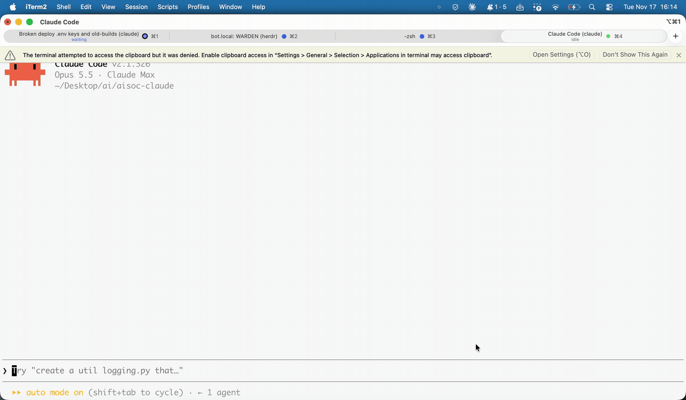

# Warden

**A local checkpoint between AI coding agents and your Mac.** Warden hooks into Claude Code, Codex CLI, Cursor,
Gemini CLI, Windsurf and Cline, and blocks secret reads, destructive deletes, download-and-run and exfiltration
before they happen, even when the agent runs with its own permission prompts switched off.

[](LICENSE)
[](#install)
[](#install)
[](https://github.com/0xdak/warden/actions/workflows/selftest.yml)

<!-- TODO: record docs/demo.gif (agent tries `cat .env` → blocked; `rm -rf ../other` → approval popup; Evidence log). Keep it under ~5 MB. -->
<p align="center"></p>

## Why

- **One app, six agents.** A native menu-bar app installs and maintains the hooks for every agent it finds, with a
  backup of each config file first. No hand-editing JSON per agent.
- **Deterministic and explainable.** Every decision names the rule and the reason
  (`secret.env: touches an environment file (.env) …`). No model in the loop, no network round trip; a check takes a
  few milliseconds.
- **Works in YOLO mode.** Hooks still run when the agent's own prompts are off (`--dangerously-skip-permissions`,
  `bypassPermissions`), and Warden flags those sessions in its log.

## Install

**Download:** get the Developer ID signed and notarized `Warden.dmg` from
[GitHub Releases](https://github.com/0xdak/warden/releases/latest). Optionally compare `shasum -a 256 Warden.dmg`
with the `.sha256` file next to it. Open the DMG, drag **Warden** to Applications, open it.

Requirements: macOS 14 or later, Apple silicon or Intel.

**Build from source** (Command Line Tools only, no Xcode: `xcode-select --install`):

```sh
git clone https://github.com/0xdak/warden.git
cd warden/app
scripts/selftest          # 343 checks against a throwaway HOME
scripts/build_app.sh      # → dist/Warden.app (universal, ad-hoc signed for local use)
```

## Quick start

1. **Pick agents and a preset.** The setup sheet lists the agents installed on your Mac. Choose which to protect and
   a preset: Strict, **Balanced** (recommended) or Permissive.
2. **Agent-specific step.** Codex: run `/hooks` once and trust the Warden hook. Cline: switch the hook on in
   Cline's Hooks tab. Restart running agent sessions.
3. **Observe.** New installs start in observe mode: nothing is stopped, and the log shows what *would* have been
   blocked or asked. Adjust rules (any rule can be set to block, ask, observe or allow).
4. **Enforce.** When the baseline looks right, press **Start enforcing** on Home.

When something needs a decision, a floating panel appears (Allow once / Allow for project / Always allow / Block;
on high-risk items Return and Esc both choose Block). No answer within 60 s → block (configurable). You can also
answer from a terminal:

```sh
~/Library/Application\ Support/Warden/bin/warden-hook approvals
~/Library/Application\ Support/Warden/bin/warden-hook approvals allow|project|block <id>
```

## What it catches

33 built-in rules, plus your own (glob / contains / regex). Defaults below are for the **Balanced** preset.
Full catalog: [`app/Sources/GuardCore/Rules.swift`](app/Sources/GuardCore/Rules.swift).

| Group | Example the agent tries | Balanced | Rule |
|---|---|---|---|
| **Secrets** | `cat .env`, Read tool on `.env.local` (`.env.example` is fine) | block | `secret.env` |
| | `ln -s ~/.aws/credentials x && cat x` (symlinks are resolved) | block | `secret.cloud` |
| | `cat .e*` (globs expanded like the shell would) | block | `secret.env` |
| | `f=.env; cat $f` (same-line variables substituted) | block | `secret.env` |
| | `python3 -c "print(open('.env').read())"` (also `node -e`, `ruby -e`, `perl -e`, `php -r`) | block | `secret.env` |
| | `~/.ssh/id_ed25519`, MCP tool reading `~/.ssh` | block | `secret.ssh` |
| | `security find-generic-password -s github -w` | block | `secret.keychain` |
| | `~/.npmrc`, `~/.git-credentials`, `~/.config/gh/hosts.yml`; browser cookie/login stores | block | `secret.tokens`, `secret.browser` |
| | `curl http://169.254.169.254/latest/meta-data/` | block | `secret.metadata` |
| | `printenv`, `env` | ask | `env.dump` |
| **Destructive** | `rm -rf ~`, `rm -rf ~/Documents`, `rm -rf ../../`, `rm -rf .git` | block | `cmd.rm-critical` |
| | `rm -rf ../other-project` (target resolved to its real path) | ask | `cmd.rm-outside` |
| | `rm -rf "$BUILD_ROOT/"` (unknown variable: can't be checked → ask) | ask | `cmd.rm-outside` |
| | `rm -rf .` / `rm -rf *` at the project root, `find . -delete` | ask | `cmd.rm-project` |
| | `dd if=/dev/zero of=/dev/disk2`, `diskutil eraseDisk`, `mkfs` | block | `cmd.disk` |
| | `git push --force`, `git reset --hard`, `git clean -fdx` | ask | `git.*` |
| **Remote code** | `curl -fsSL https://… \| sh` | ask | `cmd.pipe-shell` |
| | `echo … \| base64 -d \| sh`, `sh -c "$(echo … \| base64 -d)"`, `curl -o x … && sh x` | ask | `cmd.pipe-shell` |
| **Exfiltration** | `curl -d @.env https://…`, `cat .env \| curl --data-binary @- …`, `tar czf - ~/.ssh \| nc …` | block | `exfil.secret` |
| | `curl -T build.zip …`, `curl -F file=@report.pdf …` | ask | `exfil.upload` |
| | `nc host 4444 < data`, `scp x host:/srv` | ask | `exfil.socket`, `exfil.remote-copy` |
| **Infra** | `terraform destroy`, `kubectl delete ns prod`, `helm uninstall`, `DROP TABLE`, `dropdb`, `crontab -r` | ask | `cmd.infra-destroy` |
| **System** | `sudo …`, `chmod -R 777 .`, `docker run -v /:/host …`, writes to `~/.zshrc` | ask | `cmd.sudo`, `cmd.chmod-777`, … |
| **Self-protection** | edits to agent hook/settings files, `disableAllHooks`, `pkill -f warden-hook` | block | `guard.tamper` (always on) |
| | `claude --dangerously-skip-permissions …`, `--yolo` | ask | `guard.bypass-flag` |

Allowed by design: deletes inside the project or the agent's start folder, and `rm -rf` under temp folders
(`/tmp/build-cache`, `d=$(mktemp -d); rm -rf "$d"`). Commands too large to analyse (over 100 KB / 20,000 words, or
hook input over 1 MB) go to you (`guard.oversize`), never straight through.

Try any command without installing anything into an agent (writes nothing):

```sh
echo '{"hook_event_name":"PreToolUse","cwd":"/tmp","tool_name":"Bash","tool_input":{"command":"cat .env"}}' \
  | ~/Library/Application\ Support/Warden/bin/warden-hook --agent claude --explain
```

## Supported agents

| Agent | Config Warden edits | Checked before they run | Notes |
|---|---|---|---|
| Claude Code | `~/.claude/settings.json` | shell, file reads/writes, MCP | Uses Claude Code's own "ask" prompt when possible |
| Codex CLI | `~/.codex/hooks.json` | shell, writes (`apply_patch`), MCP; reads via shell parsing | **Run `/hooks` once and trust the Warden hook.** No native ask → Warden's popup |
| Cursor | `~/.cursor/hooks.json` | shell, file reads, MCP; edits partly | Installed with `failClosed: true` |
| Gemini CLI | `~/.gemini/settings.json` | shell, file reads/writes, MCP | Popup for asks |
| Windsurf | `~/.codeium/windsurf/hooks.json` | shell, file reads/writes, MCP | Popup for asks |
| Cline | `~/Documents/Cline/Hooks/PreToolUse` | shell, file reads/writes, MCP | **Switch the hook on in Cline's Hooks tab.** Popup for asks |

Install is idempotent, keeps your own hooks and settings, refuses files that aren't plain JSON (JSONC with comments
is left untouched), and backs up every file it touches. **Remove** takes out only Warden's entries; **Restore
backup** puts back the exact file. The app re-checks the configs every 5 s and warns (or re-installs) if the hooks
disappear or `disableAllHooks` is set.

## How it works

```
agent ──stdin JSON──► warden-hook --agent X ──► parse → rules → remembered decisions → (ask the app) → log → answer
```

Each agent calls a small native CLI before every action. It parses the action (a quote-aware shell lexer that
follows pipelines, `$( )`, `bash -c`, `cd`, variables, symlinks and globs), evaluates the rules, asks the menu-bar
app over a local Unix socket only when a person has to choose, appends a redacted record to a JSONL log and answers
in the agent's own format. Hard blocks don't need the app to be running.
Details: [app/ARCHITECTURE.md](app/ARCHITECTURE.md).

## Privacy

- Local only: no account, no telemetry, no update checks. The app makes no network requests of its own.
- Everything lives in `~/Library/Application Support/Warden` (mode 0700). Keys, tokens and passwords are masked
  before a record is written.
- The socket between hook and app is 0600 and checks the peer's user id.

## Limitations

Warden reduces risk; it is not a sandbox.

- **Hooks are the enforcement point.** If an agent doesn't call its hooks for some action, Warden never sees it.
  Examples: hooks disabled, a Codex hook you haven't trusted yet, Cline with the hook switched off, hosted tools that
  run on the vendor's servers, and agent bugs where some paths skip hooks (see Claude Code issues about subagent paths, e.g.
  [#88441](https://github.com/anthropics/claude-code/issues/88441)). Agents without a pre-action hook (e.g. Aider) aren't supported.
- **Static analysis has limits.** Warden sees the command, not what a script does later: `python build.py` is judged
  as `python build.py`. String building (`'.e'+'nv'`) and heavier obfuscation can get past pattern rules. Where a
  path can't be resolved, recursive deletes ask; a plain `cat "$f"` with an unknown `$f` is allowed to keep noise down.
- **Processes started by an allowed command run with your full permissions.** For untrusted code, also use a
  container, VM or separate macOS user.
- **Output isn't scanned.** Secrets that end up in files the agent writes, or in tool output, aren't detected yet.
- **Deletes under temp folders are allowed by design**, as are deletes inside the project.

Found a bypass? Please report it privately; see [SECURITY.md](SECURITY.md).

## FAQ

**How is this different from Claude Code's auto mode?**
Auto mode uses a model-based classifier to decide which actions need a prompt. [Anthropic's own published evaluation](https://www.anthropic.com/engineering/claude-code-auto-mode)
reports a ~17% false-negative rate on a curated set of real overeager actions, and Anthropic says it reduces prompts
rather than guaranteeing safety. Warden is deterministic: the same command always gets the same answer, with the rule
that fired. They can run together. Warden also covers five other agents.

**Why not a sandbox?**
Sandboxes (containers, `sandbox-exec`, a separate user) are stronger isolation and you should use one for untrusted
code. Warden works at a different level: it knows *which agent* tried *which action* in *which project*, asks you in
context, and keeps an explainable log, without changing how you start your agents. They combine well.

**Doesn't `.cursorignore` already handle this?**
`.cursorignore` controls what Cursor indexes and reads through its file tools. It doesn't cover terminal commands, so
`cat .env` in the agent's shell isn't stopped by it. Warden checks shell commands, file reads and MCP calls.

**Why not write my own hooks?**
You can, and hook packs exist. Warden adds the parts that are tedious to get right: one install for six agents with
six input formats, backups and clean uninstall, symlink/glob/variable resolution, an approval UI, per-project memory,
and tamper protection for the hooks themselves.

**Does it slow the agent down?**
Not noticeably. The hook is a native binary that decides from local rules in a few milliseconds. You only wait when
it asks you something.

**What if the app isn't running?**
Hard blocks still apply. For "ask" decisions, Claude Code and Cursor fall back to their own prompt; for the others
you choose in Settings (default: block and tell the agent to ask you to open Warden).

## Uninstall

In Warden ▸ Agents press **Remove** for each agent, quit Warden, delete it from Applications, and optionally delete
`~/Library/Application Support/Warden`. More in [app/README.md](app/README.md#uninstall).

## Contributing

Bypass reports, new rules with test cases, and agent-adapter fixes are the most useful contributions. See
[CONTRIBUTING.md](CONTRIBUTING.md). Never test against your real agent configs; use `WARDEN_HOME_OVERRIDE`.

## License

[MIT](LICENSE). Claude Code, Codex, Cursor, Gemini CLI, Windsurf and Cline are trademarks of their respective
owners. Warden is independent and not affiliated with or endorsed by them.
